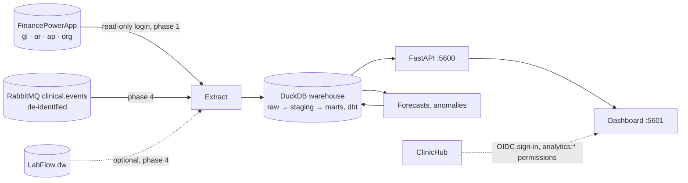

# Architecture and phases

Analytics is the reporting and forecasting service of the [ClinicHub](https://github.com/ArashKeshtgar/ClinicHub)
platform: the group's money (from FinancePowerApp) and the clinics' operations (orders, turnaround, cancellations,
from IntegrationHub's event feed) in one warehouse, a dashboard per clinic and for the group, and forecasts. It is
written in **Python**, because that is where data work and machine learning live.

It **reads only**. It never writes to another application, so it cannot break one.

## Decisions

1. **Health information never enters.** Phase 1 uses only the accounting, which by design holds no patient names,
   health cards, diagnoses or fee codes ("Patients" is one party). Clinical data arrives from IntegrationHub already
   de-identified: a patient is an HMAC pseudonym, there are no names, birth dates, notes or result values. A field
   that looks like health information in a source is a bug to report, not a column to load.
2. **Reading FinancePowerApp's database is a deliberate, narrow exception** to "applications talk through APIs":
   a dedicated SQL login with `SELECT` only on the `org`, `gl`, `ar`, `ap`, `tax` schemas and `dbo.AccountingPeriods`.
   It is the usual warehouse extract. If FinancePowerApp later offers an export API, switch to it.
3. **A clinic sees only its own numbers.** In FinancePowerApp, each clinic is a business whose `sourceKey` is
   ClinicHub's clinic slug. A user signed in for a clinic sees that business; the group view needs
   `analytics:group.view`.
4. **Reproducible from scratch.** The warehouse is a file (`data/warehouse.duckdb`) rebuilt by `analytics build`; raw
   extracts are kept as Parquet per run, so a model change can be rerun without touching the sources.
5. **Forecasts are judged against a baseline.** Every model is backtested against a seasonal-naive forecast, and
   the dashboard shows the baseline when the model does not beat it.

## Stack

Python 3.12, uv (dependencies, lockfile), FastAPI + Uvicorn, DuckDB, dbt-core + dbt-duckdb, Polars, pyodbc (SQL Server
ODBC Driver 18), pika or aio-pika (phase 4), statsmodels / scikit-learn (phase 5), Authlib/PyJWT for ClinicHub tokens,
pytest, ruff, mypy, GitHub Actions. Web: React + Vite + TypeScript, like the other applications. API `:5600`, web
`:5601`.

## Phases

| Phase | What | Status |
|---|---|---|
| 0 | Skeleton: package, CLI, health, CI, Docker | **Done** |
| 1 | Finance warehouse: extract FinancePowerApp, dbt marts, API | Not started |
| 2 | Sign-in through ClinicHub, clinic-scoped access | Not started |
| 3 | Dashboard web: revenue, OHIP collection, receivables, HST | Not started |
| 4 | Operations: de-identified events from IntegrationHub, turnaround, the clinic operations dashboard | Not started |
| 5 | Forecasts and anomalies, with backtests and model cards | Not started |
| 6 | Scheduling, data-quality checks, platform compose | Not started |

Each phase ends with tests green in CI, this table and the README's status list updated. Changes needed in other
repositories are listed per phase; they are made there, in their own commits, and noted here.

### Phase 0 — Skeleton

- `pyproject.toml` (uv), package `analytics` under `src/`, CLI `analytics` (Typer): `extract`, `build`, `serve`.
- FastAPI app: `GET /healthz`, `GET /api/version`.
- `dbt/` project (profile on DuckDB), empty `staging/` and `marts/`.
- ruff + mypy (strict on `src/`) + pytest; GitHub Actions on push; `Dockerfile` (python:3.12-slim + ODBC driver).
- `.env.example` with every setting; settings read with pydantic-settings.

**Done when:** `uv run pytest`, `uv run ruff check`, `uv run mypy src` pass in CI and `analytics serve` answers on `:5600`.

**Built:** all of the above. `analytics build` runs dbt on the (empty) project; `analytics extract finance` exists but
exits with code 2 and says it is not built (phase 1). Not yet seen running: the first CI run on GitHub, and
`docker build` (see README).

### Phase 1 — Finance warehouse

- **Extract** (`analytics extract finance`): from FinancePowerApp (connection string from settings), tables of the
  schemas in decision 2, to `data/raw/finance/{run}/{table}.parquet`, incremental by posted date/id where the table
  allows, full otherwise. A run log table (`meta.load_run`: started, finished, rows per table, status, error), like
  LabFlow's `etl.LoadRun`.
- The source tables and columns are in [sources.md](sources.md) (copied from FinancePowerApp, which has no GitHub
  remote yet). Its reports' SQL (`database/030_reports.sql`) is not copied; the reports' answers are what the
  cross-check tests compare against.
- **dbt models:** `stg_*` per source table; marts `dim_business` (`org.Entity` + its `org.EntitySource` keys; kind: Clinic, Lab, Diagnostics, Pharmacy, Holding),
  `dim_account` (with GIFI line and revenue/expense grouping), `dim_period`, `dim_party` (`PartyType`: OHIP, ODB, WSIB,
  Province, Insurer, Patient, Provider, Supplier, Other; no e-mail or phone), `fact_gl_line` (posted entries only; reversals included as they are),
  `fact_open_item_snapshot` (receivable/payable balance per item per day, for aging), `mart_revenue_monthly`
  (business × line of business × provider code × month), `mart_ohip_collection` (billed, paid, short-paid, refused,
  days to pay).
- **Checks** (dbt tests): every entry balances (debits = credits), every line has a business and account, trial balance
  per business equals FinancePowerApp's `/api/reports/trial-balance` for a sample date (test against a recorded answer).
- **API:** `GET /api/finance/revenue?business=&from=&to=&groupBy=`, `/api/finance/ohip-collection`, `/api/finance/aging`.
- **Tests:** a small synthetic source (DuckDB or SQL Server in Testcontainers seeded from fixtures), the marts' numbers
  checked by hand-computed expectations.
- **Other repositories:** FinancePowerApp — a script `database/050_analytics_reader.sql` creating the read-only login
  and grants (made there).

### Phase 2 — Sign-in through ClinicHub

- Web signs in with OIDC (authorization code + PKCE) against `http://localhost:5301/`; the API validates ClinicHub
  access tokens (JWKS). Claims used: `sub`, `name`, `clinic_slug`, `permission`.
- Permissions: `analytics:dashboard.view` (own clinic), `analytics:group.view` (every business), `analytics:models.view`.
  Every API query is filtered by business from the token unless `group.view`.
- **Other repositories:** ClinicHub — register client `analytics` in `Sso:Clients` (redirects
  `http://localhost:5601/signin-oidc`), add the three permissions to the permission list and to the built-in roles
  (Administrator: all; Physician: dashboard.view). See how `labflow:*` was added there.

### Phase 3 — Dashboard

- React + Vite + TypeScript in `web/`, charts with one consistent palette, light and dark.
- Pages: **Overview** (revenue this month vs last year, by line of business), **OHIP** (billed vs paid, short-paid
  and refused rate, days to pay, by provider), **Receivables** (aging buckets per payer type), **HST** (GST34 lines per
  period, matching FinancePowerApp's report), **Group** (businesses side by side, `group.view` only).
- CSV download on every table. Numbers on the dashboard match FinancePowerApp's own reports for the same period —
  a test checks one of each.

### Phase 4 — Operations

Depends on IntegrationHub phase 3 (the `clinical.events` feed, schema in its `docs/events.md`).

- Consumer (`analytics consume`) writes events to `raw.clinical_event` (idempotent on event id), dbt models
  `fact_order` (placed → accepted → resulted/cancelled, per test), `mart_turnaround` (order to result, by test, lab
  vs diagnostics, clinic, priority, median and 90th percentile), `mart_cancellations` (cancelled, refused cancels).
- Dashboard page **Operations**: this is ClinicHub's open README item "Clinic operations dashboard".
- Optional: LabFlow `dw` (already de-identified star schema) as a second source for lab volumes.

### Phase 5 — Forecasts and anomalies

- **Revenue forecast** per business and line of business, monthly, 6 months ahead: seasonal-naive baseline,
  then ETS/SARIMA (statsmodels), then gradient boosting with calendar features if it helps. Rolling-origin backtest,
  MAPE and MASE stored per run in `ml.backtest`; the chosen model per series is the one with the best MASE, baseline
  if nothing beats it.
- **Remittance anomalies:** short-paid / refused rate per provider and month against its own history (robust z-score);
  flagged on the OHIP page with the numbers behind the flag.
- A model card per model in `docs/models/` (data, period, metrics, limits). No model on patient-level data.

### Phase 6 — Operations of the service

- `analytics run` = extract + build + score, scheduled (cron in the container, or the platform's scheduler).
- Data-quality report after each run (row counts vs last run, failed dbt tests) at `GET /api/meta/runs`.
- Join the platform compose (ControlPanel); Docker image built in CI.

## Not in scope

- Writing to any other application. Patient-level analytics. Real OHIP data. Replacing FinancePowerApp's own reports
  (Analytics adds trends and forecasts, the books stay in FinancePowerApp).
