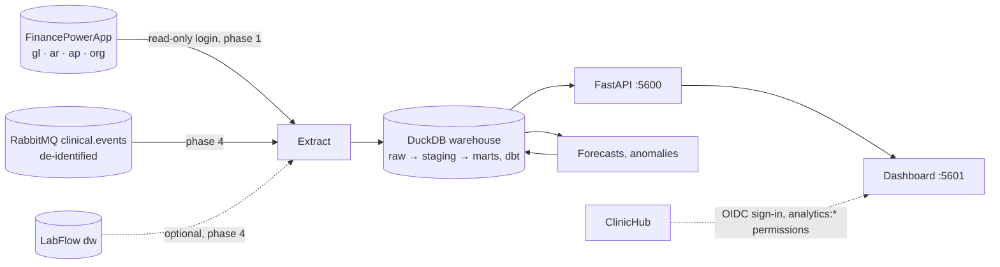

# Architecture and phases

Analytics is the reporting and forecasting service of the [ClinicHub](https://github.com/ArashKeshtgar/ClinicHub)
platform: the group's money (from FinancePowerApp) and the clinics' operations (orders, turnaround, cancellations,
from IntegrationHub's event feed) in one warehouse, a dashboard per clinic and for the group, and forecasts. It is
written in **Python**, because that is where data work and machine learning live.

It **reads only**. It never writes to another application, so it cannot break one.



## Decisions

1. **Health information never enters.** Phase 1 uses only the accounting, which by design holds no patient names,
   health cards, diagnoses or fee codes ("Patients" is one party). Clinical data arrives from IntegrationHub already
   de-identified: a patient is an HMAC pseudonym, there are no names, birth dates, notes or result values. A field
   that looks like health information in a source is a bug to report, not a column to load.
2. **Reading FinancePowerApp's database is a deliberate, narrow exception** to "applications talk through APIs":
   a dedicated SQL login with `SELECT` only on the `org`, `gl`, `ar`, `ap`, `tax` schemas and `dbo.AccountingPeriods`.
   It is the usual warehouse extract. If FinancePowerApp later offers an export API, switch to it.
3. **A clinic sees only its own numbers.** In FinancePowerApp, each clinic is a business whose `sourceKey` is
   ClinicHub's clinic slug. A user signed in for a clinic sees that business; the group view needs
   `analytics:group.view`.
4. **Reproducible from scratch.** The warehouse is a file (`data/warehouse.duckdb`) rebuilt by `analytics build`; raw
   extracts are kept as Parquet per run, so a model change can be rerun without touching the sources.
5. **Forecasts are judged against a baseline.** Every model is backtested against a seasonal-naive forecast, and
   the dashboard shows the baseline when the model does not beat it.

## Stack

Python 3.12, uv (dependencies, lockfile), FastAPI + Uvicorn, DuckDB, dbt-core + dbt-duckdb, Polars, pyodbc (SQL Server
ODBC Driver 18), pika or aio-pika (phase 4), statsmodels / scikit-learn (phase 5), Authlib/PyJWT for ClinicHub tokens,
pytest, ruff, mypy, GitHub Actions. Web: React + Vite + TypeScript, like the other applications. API `:5600`, web
`:5601`.

## Phases

| Phase | What | Status |
|---|---|---|
| 0 | Skeleton: package, CLI, health, CI, Docker | **Done** |
| 1 | Finance warehouse: extract FinancePowerApp, dbt marts, API | **Done** (with the gaps listed under the phase) |
| 2 | Sign-in through ClinicHub, clinic-scoped access | **Done** in the API; the web sign-in comes with the web in phase 3 |
| 3 | Dashboard web: revenue, OHIP collection, receivables, HST | **Done**, except the comparison with FinancePowerApp's own reports (see below) |
| 4 | Operations: de-identified events from IntegrationHub, turnaround, the clinic operations dashboard | **Done**, except the optional LabFlow `dw` source |
| 5 | Forecasts and anomalies, with backtests and model cards | Not started |
| 6 | Scheduling, data-quality checks, platform compose | Not started |

Each phase ends with tests green in CI, this table and the README's status list updated. Changes needed in other
repositories are listed per phase; they are made there, in their own commits, and noted here.

### Phase 0 — Skeleton

- `pyproject.toml` (uv), package `analytics` under `src/`, CLI `analytics` (Typer): `extract`, `build`, `serve`.
- FastAPI app: `GET /healthz`, `GET /api/version`.
- `dbt/` project (profile on DuckDB), empty `staging/` and `marts/`.
- ruff + mypy (strict on `src/`) + pytest; GitHub Actions on push; `Dockerfile` (python:3.12-slim + ODBC driver).
- `.env.example` with every setting; settings read with pydantic-settings.

**Done when:** `uv run pytest`, `uv run ruff check`, `uv run mypy src` pass in CI and `analytics serve` answers on `:5600`.

**Built:** all of the above. `analytics build` runs dbt on the (empty) project; `analytics extract finance` exists but
exits with code 2 and says it is not built (phase 1). Not yet seen running: the first CI run on GitHub, and
`docker build` (see README).

### Phase 1 — Finance warehouse

- **Extract** (`analytics extract finance`): from FinancePowerApp (connection string from settings), tables of the
  schemas in decision 2, to `data/raw/finance/{run}/{table}.parquet`, incremental by posted date/id where the table
  allows, full otherwise. A run log table (`meta.load_run`: started, finished, rows per table, status, error), like
  LabFlow's `etl.LoadRun`.
- The source tables and columns are in [sources.md](sources.md) (copied from FinancePowerApp, which has no GitHub
  remote yet). Its reports' SQL (`database/030_reports.sql`) is not copied; the reports' answers are what the
  cross-check tests compare against.
- **dbt models:** `stg_*` per source table; marts `dim_business` (`org.Entity` + its `org.EntitySource` keys; kind: Clinic, Lab, Diagnostics, Pharmacy, Holding),
  `dim_account` (with GIFI line and revenue/expense grouping), `dim_period`, `dim_party` (`PartyType`: OHIP, ODB, WSIB,
  Province, Insurer, Patient, Provider, Supplier, Other; no e-mail or phone), `fact_gl_line` (posted entries only; reversals included as they are),
  `fact_open_item_snapshot` (receivable/payable balance per item per day, for aging), `mart_revenue_monthly`
  (business × line of business × provider code × month), `mart_ohip_collection` (billed, paid, short-paid, refused,
  days to pay).
- **Checks** (dbt tests): every entry balances (debits = credits), every line has a business and account, trial balance
  per business equals FinancePowerApp's `/api/reports/trial-balance` for a sample date (test against a recorded answer).
- **API:** `GET /api/finance/revenue?business=&from=&to=&groupBy=`, `/api/finance/ohip-collection`, `/api/finance/aging`.
- **Tests:** a small synthetic source (DuckDB or SQL Server in Testcontainers seeded from fixtures), the marts' numbers
  checked by hand-computed expectations.
- **Other repositories:** FinancePowerApp — a script `database/050_analytics_reader.sql` creating the read-only login
  and grants (made there).

**Built:**

- `analytics extract finance` (pyodbc, read-only connection) writes `data/raw/finance/{run}/{table}.parquet` and
  logs the run in `meta.load_run` / `meta.load_run_table` (a failed run is logged with the error type and first
  line only). Columns are listed one by one in `finance_tables.py`; free text, staff names, contact details and
  document references are not extracted (a test enforces this).
- `analytics build` loads the Parquet runs into schema `raw` (current tables from the latest run; an open-item
  history with one snapshot per day, rebuilt from the runs kept on disk) and runs `dbt build`. It exits 1 when there
  is no extract yet.
- dbt: `stg_*`, `dim_business`, `dim_account`, `dim_period`, `dim_party`, `fact_gl_line`, `fact_open_item_snapshot`,
  `mart_revenue_monthly`, `mart_ohip_collection`; tests: unique/not-null/relationships, every entry balances, every
  business balances.
- API: `GET /api/finance/revenue` (`business`, `from`, `to`, `groupBy` = comma list of
  `month|business|lineOfBusiness|provider`), `/api/finance/ohip-collection`, `/api/finance/aging` (`business`,
  `asOf`, `side`). Amounts are returned as numbers rounded to cents.
- `docs/finance-reader.sql`: the read-only login (to be copied to FinancePowerApp as `database/050_analytics_reader.sql`).

**Not built, said plainly:**

- Incremental extract: every run is a full copy (FinancePowerApp's entries change status and items change balance, so
  "newer than" would miss updates). Fine at this size; revisit if a table grows.
- Days to pay in `mart_ohip_collection` (no payment date in the source, question 6 in sources.md).
- The cross-check of the trial balance against `/api/reports/trial-balance` (question 7). What exists is the
  internal check that every entry and every business balances.
- Ageing history only starts at the first extract; days without a run have no snapshot.
- No sign-in: the API is open and meant for localhost until phase 2.
- Not run against a real SQL Server: `SqlServerSource` and `docs/finance-reader.sql` are untested; tests use a
  DuckDB database with FinancePowerApp's table names and columns as the synthetic source.
- Several mart rules rest on assumptions about FinancePowerApp (sources.md, questions 1–5).

### Phase 2 — Sign-in through ClinicHub

- Web signs in with OIDC (authorization code + PKCE) against `http://localhost:5301/`; the API validates ClinicHub
  access tokens (JWKS). Claims used: `sub`, `name`, `clinic_slug`, `permission`.
- Permissions: `analytics:dashboard.view` (own clinic), `analytics:group.view` (every business), `analytics:models.view`.
  Every API query is filtered by business from the token unless `group.view`.
- **Other repositories:** ClinicHub — register client `analytics` in `Sso:Clients` (redirects
  `http://localhost:5601/signin-oidc`), add the three permissions to the permission list and to the built-in roles
  (Administrator: all; Physician: dashboard.view). See how `labflow:*` was added there.

**Built (this repository):**

- The API checks ClinicHub access tokens (`auth.py`): RS256 signature against `{issuer}.well-known/jwks`
  (`ANALYTICS_OIDC_JWKS_URI` overrides), issuer, expiry (60 s leeway), `sub`; the audience only when
  `ANALYTICS_OIDC_AUDIENCE` is set. `alg: none`, HS256 and unknown `kid` are refused. No token or a bad one is `401`
  with `WWW-Authenticate: Bearer`; ClinicHub's keys unreachable is `503`; a valid token without a finance permission is
  `403`. The token is never logged or echoed.
- `permission` (a list or one space-separated string), `clinic_slug` and `name` are read from the token.
  `analytics:group.view` sees every business. `analytics:dashboard.view` sees only the business whose
  `dim_business.clinic_slug` equals the token's `clinic_slug` (case-insensitive); with no `clinic_slug` it is `403`.
  The clinic from the token always applies; a `business` in the request narrows it further, so asking for another
  clinic gives an empty list, not an error and not that clinic's numbers. This holds for revenue, OHIP collection and
  ageing.
- `GET /api/me`: name, clinic, permissions and `scope` (`group`, `clinic` or `none`) for any valid token; the dashboard
  uses it to decide what to show. `/healthz` and `/api/version` stay open.
- CORS: only `ANALYTICS_WEB_ORIGIN` (default `http://localhost:5601`), `GET`, `Authorization`.
- There is no switch to turn authentication off. To call the API by hand you need a ClinicHub token.
- Tests (52 in all, 24 for this phase) sign tokens with a key generated per run and serve the JWKS from a local HTTP
  server, so the real key fetching is exercised. Checked by breaking the clinic filter: three tests fail.

**Not built, said plainly:**

- The web's sign-in (authorization code + PKCE, `/signin-oidc`): there is no web yet. It is the first item of phase 3.
- `analytics:models.view` is recognised (and shown by `/api/me`) but guards nothing: the model pages are phase 5.
- No revocation or session handling: a token is good until it expires; the keys are cached by PyJWT (5 minutes).
- Never run against a real ClinicHub token (see the questions in sources.md).

**Other repositories — to do locally, not done:** the ClinicHub change in the item above, and in addition that the
`analytics` client's access tokens must carry the claims `permission` and `clinic_slug` (OpenIddict only puts a claim
in the token if it has the `access_token` destination; check how `labflow:*` and `clinic_slug` get there).

### Phase 3 — Dashboard

- React + Vite + TypeScript in `web/`, charts with one consistent palette, light and dark.
- Pages: **Overview** (revenue this month vs last year, by line of business), **OHIP** (billed vs paid, short-paid
  and refused rate, days to pay, by provider), **Receivables** (aging buckets per payer type), **HST** (GST34 lines per
  period, matching FinancePowerApp's report), **Group** (businesses side by side, `group.view` only).
- CSV download on every table. Numbers on the dashboard match FinancePowerApp's own reports for the same period —
  a test checks one of each.

**Built:**

- `web/`: React 19 + Vite + TypeScript. Sign-in is the authorization code flow with PKCE against ClinicHub (client
  `analytics`, redirect `/signin-oidc`, library `oidc-client-ts`); the token is kept in the tab's session storage; an
  expired token or a `401` sends the user through sign-in again and back to the same page. Permissions come from
  `/api/me`, not from reading the token. Sign-out clears the tab's session only (it does not end the ClinicHub session).
- One filter row above everything: Last 12 / 6 / 3 months, Year to date, Last year (counted back from the **latest month
  with data**, not from today) and, for group users, the business. A reload keeps the previous render, dimmed.
- **Overview**: the one hero figure (revenue of the latest month and the change against the same month a year earlier),
  revenue by line of business (this month against a year earlier) and a monthly line with the year-earlier line.
  **OHIP**: billed, paid, outstanding, refused and short-paid rate; billed and paid by month; the two rates by month; a
  by-provider table. **Receivables** (and payables): ageing buckets per payer type as a stacked bar, on the last
  snapshot up to the end of the range. **HST**: sales by tax code, HST collected, ITCs and net tax by month or quarter.
  **Group** (`analytics:group.view` only): businesses side by side.
- Every chart has a table twin (the Chart / Table switch) and every table downloads as CSV (raw numbers, quoted
  per RFC 4180, a text cell that starts with `=`, `+`, `-` or `@` is neutralised, UTF-8 with a byte order mark).
- Charts: hand-written SVG; marks at most 24 px, rounded at the data end, a 2 px gap between neighbours; one tooltip
  with every series, also on keyboard focus and arrow keys; legend for two or more series that hides a series (never
  the last); hover lifts the mark; colours follow the entity (categorical slots 1 and 2, a gray for "a year
  earlier", a five-step one-hue ramp for the ageing buckets). The palette was run through the validator
  (light and dark): slots 1–3 pass all-pairs; slot 3 (aqua) is below 3:1 on the light surface, so it is not used; the
  ageing ramps pass as ordinal. Dark mode follows the system and can be set with the toggle (remembered in this browser).
- API additions the pages needed: `GET /api/finance/businesses`, `/range`, `/ohip-providers`, `/hst`, and dbt models
  `mart_hst_period` and `mart_ohip_provider_monthly`, all clinic-scoped like the rest. Staging now casts nullable text
  columns: an all-NULL column (no tax code posted yet) is typed "null" in Parquet and broke the models.
- Tests: 76 in Vitest (formats, CSV, periods, the data shaping, chart paths and tooltips, the API client, the
  reload hook, the filter-to-request mapping), 24 in a real browser (Playwright: sign-in with PKCE against a fake
  ClinicHub that refuses a wrong verifier, expiry, each page's numbers worked out by hand, filters, CSV download,
  dark mode, no horizontal scroll at 390 px, no console errors), and 17 more Python tests (the new endpoints and
  marts, an all-NULL source column, the fake sign-in).

**Not built, said plainly:**

- **"Numbers match FinancePowerApp's own reports — a test checks one of each" is not done.** There is no recorded
  answer of those reports in this repository and no access to FinancePowerApp. The numbers are checked against
  hand-computed expectations of the synthetic data only. The HST page is read from the journal and is **not** the
  GST34 return: no line numbers, the filing period is not known, and it has not been compared with FinancePowerApp's
  HST report (the page says so). Questions are in sources.md.
- Days to pay (no payment date in the source) and "paid" by provider.
- Texture fills for print and forced colors; an automated accessibility audit; screen-reader testing.
- Silent token renewal, ending the ClinicHub session on sign-out, a production build served by anything but
  `vite preview` (the platform compose is phase 6), a Docker image of the web.
- Not seen working with the real ClinicHub.

**Other repositories — to do locally, not done** (in addition to phase 2's list):

1. ClinicHub: the `analytics` client must be a **public** client (no secret) allowed the authorization code flow with
   PKCE, with redirect `http://localhost:5601/signin-oidc` and post-logout `http://localhost:5601/`.
2. ClinicHub: the browser calls the discovery document, the JWKS and **`/connect/token`** directly, so ClinicHub must
   allow CORS from `http://localhost:5601` on those endpoints. Without it the page cannot sign in.
3. ClinicHub: which scopes may the client ask for? The page asks for `openid profile` (`VITE_OIDC_SCOPE`); the
   access token must carry `permission`, `clinic_slug` and `name`.

### Phase 4 — Operations

Depends on IntegrationHub phase 3 (the `clinical.events` feed, schema in its `docs/events.md`).

- Consumer (`analytics consume`) writes events to `raw.clinical_event` (idempotent on event id), dbt models
  `fact_order` (placed → accepted → resulted/cancelled, per test), `mart_turnaround` (order to result, by test, lab
  vs diagnostics, clinic, priority, median and 90th percentile), `mart_cancellations` (cancelled, refused cancels).
- Dashboard page **Operations**: this is ClinicHub's open README item "Clinic operations dashboard".
- Optional: LabFlow `dw` (already de-identified star schema) as a second source for lab volumes.

**Built:**

- `analytics consume` (`events.py`, pika): declares the topic exchange `clinical.events`, the durable queue
  `analytics.clinical-events` and the `#` binding exactly as IntegrationHub does (durable, no arguments, idempotent),
  reads with a prefetch of one batch, writes each batch as a Parquet file under `data/raw/events/` (to a temporary file,
  `fsync`, rename) and **only then acknowledges it**. If the write fails nothing is acknowledged and the broker gives the
  messages out again (tested with a broken writer). `--drain` reads what is waiting and stops (for a schedule, phase 6);
  without it the command keeps running and reconnects with a growing pause. A connection error never prints the URL or
  the password.
- **A strict allow-list in front of everything that is kept.** Every field must look like what IntegrationHub's contract
  says it is: a pseudonym is 64 hex characters, an order id is `service-request|` and a plain token, a priority is one of
  routine, urgent, asap, stat, a test code has no spaces. An event that does not fit is rejected whole; the rejection is
  written as a **reason code** (with the event id and type when those are well formed) and never as the value. Fields the
  contract does not name are dropped before anything is written (tested with a name, a health card and a note planted in
  events, searching every byte on disk). `schemaVersion` other than 1 is rejected as `unsupported-schema-version`.
  `finance.document` is ignored: money comes from FinancePowerApp's database, and counting it twice would be wrong.
- `analytics build` loads the Parquet files into `raw.clinical_event`, **one row per event id** (the first received wins:
  delivery is at least once, and a repeated event is in the files twice), and runs dbt. With no events at all the table
  is empty and the models still build.
- dbt: `stg_clinical_event`; `fact_order` (one row per order, built from its events in whatever order they arrived:
  placed, accepted, first and last final result, amendments, cancel, refused cancels, status, department
  Lab = LabFlow and Diagnostics = ClinicReport, turnaround in minutes from placed to the first final result);
  `mart_turnaround` (clinic, month placed, department, test, priority: orders placed and resulted, median and 90th
  percentile); `mart_cancellations`. Tests: one row per event and per order, no result before its order, and the usual
  not-null and accepted-values.
- API (clinic-scoped like the rest; a clinic user's own clinic always applies): `GET /api/operations/turnaround`
  (`clinic`, `department`, `from`, `to`, `groupBy` = comma list of `month|clinic|department|test|priority`, or `none`),
  `/api/operations/cancellations`, `/api/operations/range`. Percentiles come from `fact_order` so any grouping is exact
  (a median of medians would not be).
- **Operations page** in the dashboard (ClinicHub's open README item "Clinic operations dashboard"): orders placed, with a
  final result, waiting, median and 90th percentile, cancelled; turnaround by test and by month; by priority; lab and
  diagnostics; cancellations and refused cancels; a department switch; a table twin and CSV for each. Durations are
  written in whole units ("2 h 45 min", "1 d 5 h") and the axis ticks fall on hours and days. The filter row now counts
  back from the later of the last finance month and the last month with events ("Data up to").
- Tests: 47 for the consumer (parsing every rejection, and against a real RabbitMQ in Testcontainers: drain, batching,
  duplicates, rejections, no trace of planted values on disk, nothing acknowledged when the write fails, reading until
  told to stop, an unreachable broker), 27 for the models and API (turnaround, percentiles, grouping, scoping, out-of-order
  events, a result before its order fails the build), 84 in Vitest and 32 in the browser (8 new for this page).
- Also found and fixed: `get_settings()` is cached for the whole process, so a test that set the environment could see an
  earlier test's values (or leave its own behind); every test now starts with a clean cache. And the page's "totals"
  request (`groupBy=`) was dropped by the client, which skips empty values, so it would have been grouped by month; the
  API takes `groupBy=none` now.

**Not built, said plainly:**

- The optional LabFlow `dw` source.
- Nothing runs the consumer and `analytics build` on a schedule yet (phase 6). The dashboard shows what the last build
  had; consumed events wait on disk until then.
- A rejected event is acknowledged and gone: there is no dead-letter queue, so an event refused for an unsupported
  `schemaVersion` cannot be replayed after Analytics learns version 2. The hub keeps published outbox rows for 7 days
  but has no replay yet.
- Test names: events carry codes only (LOINC, ClinicReport template keys), so the page shows codes.
- Not seen with the real IntegrationHub: the tests publish events as its `docs/events.md` describes, against a real
  RabbitMQ.
- `patient_pseudonym` is stored in `fact_order` (a later phase may count patients) but no page or endpoint shows it.

**Other repositories — to do locally, not done:**

1. ClinicHub: tick the README item "Clinic operations dashboard". The Operations page is open to every `dashboard.view`
   user of the clinic and to `group.view`.
2. RabbitMQ: a real account for Analytics (the development `guest` only works from the same host). Done on the
   development broker (IntegrationHub's `compose.yml`), see [The RabbitMQ account](#the-rabbitmq-account) below.
3. IntegrationHub must be running with `HUB_EVENTS_ENABLED=true` for any events to exist; until Analytics first starts
   the hub's own declared queue keeps what is published.

#### The RabbitMQ account

`analytics consume` only checks that the exchange exists (passive declare): the exchange is IntegrationHub's, so
Analytics needs no configure permission on it. It declares its queue and binds it, and **binding is a write on the
queue**, so the account needs write there too (tested: without it the broker refuses the binding with 403).

```bash
docker compose exec rabbitmq rabbitmqctl add_user analytics '<password>'
docker compose exec rabbitmq rabbitmqctl set_permissions -p / analytics \
  '^analytics\.clinical-events$' '^analytics\.clinical-events$' '^(analytics\.clinical-events|clinical\.events)$'
```

(configure, write, read). Then `ANALYTICS_RABBITMQ_URL=amqp://analytics:<password>@<broker>:5672/`. The exchange
appears when the hub publishes its first event; before that the consumer says so and stops (`--drain`) or retries.
IntegrationHub in a container needs an account of its own for the same reason (configure and write on both, read on
the exchange). Also found: on Windows `fsync` of a read-only handle fails, so no batch could be written there; fixed.

### Phase 5 — Forecasts and anomalies

- **Revenue forecast** per business and line of business, monthly, 6 months ahead: seasonal-naive baseline,
  then ETS/SARIMA (statsmodels), then gradient boosting with calendar features if it helps. Rolling-origin backtest,
  MAPE and MASE stored per run in `ml.backtest`; the chosen model per series is the one with the best MASE, baseline
  if nothing beats it.
- **Remittance anomalies:** short-paid / refused rate per provider and month against its own history (robust z-score);
  flagged on the OHIP page with the numbers behind the flag.
- A model card per model in `docs/models/` (data, period, metrics, limits). No model on patient-level data.

### Phase 6 — Operations of the service

- `analytics run` = extract + build + score, scheduled (cron in the container, or the platform's scheduler).
- Data-quality report after each run (row counts vs last run, failed dbt tests) at `GET /api/meta/runs`.
- Join the platform compose (ControlPanel); Docker image built in CI.

## Not in scope

- Writing to any other application. Patient-level analytics. Real OHIP data. Replacing FinancePowerApp's own reports
  (Analytics adds trends and forecasts, the books stay in FinancePowerApp).
